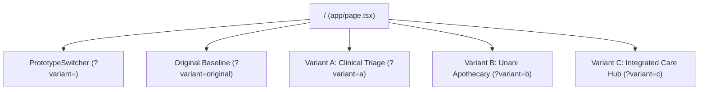

# Discovery Report: Homepage UI/UX Redesign
**Branch:** `prototype`  
**Reference:** [docs/HOMEPAGE-REDESIGN-PRD.md](file:///C:/Users/ALICOM4/projects/tms/docs/HOMEPAGE-REDESIGN-PRD.md)  
**Standard:** `.agents/skills/prototype/UI.md` (Sub-shape A: In-app Homepage Prototype)

---

## 1. Executive Summary & Objective

Tameer-e-Sehat (established 1990 in Karachi, Pakistan) is a traditional Unani and herbal healthcare clinic providing clinical Hakeem consultations, Sunnah Hijama cupping, and 500+ classical steam-distilled and honey-preserved botanical remedies.

The redesign objective is to increase completed consultation bookings and qualified enquiries by clarifying user journeys, elevating brand authority, and eliminating conflicting conversion paths without breaking existing platform functionality.

---

## 2. Technical Stack & Repository Architecture

- **Framework:** Next.js `16.3.5` (App Router)
- **Runtime / Language:** React `19.2.8`, TypeScript `5.9.3`
- **Styling & Design Tokens:** Tailwind CSS v4 `@theme` tokens in `app/globals.css`
- **Component Primitives:** Radix UI dialogs, accordions, tabs, Framer Motion
- **Icons:** `lucide-react`
- **Database & Auth:** Prisma `7.10.0` (Postgres adapter), Better Auth `1.7.4`
- **State Management:**
  - `ConsultationContext` (`app/context/ConsultationContext.tsx`): Manages WhatsApp & in-person consultation modal state.
  - `CartContext` (`app/context/CartContext.tsx`): Persistent shopping bag & COD checkout drawer.

---

## 3. Design System & Palette Reconciliation

The tokens defined in `app/globals.css` match the PRD specification:

| Token Role | Color Token | Value | Applied To |
|---|---|---|---|
| **Primary** | `--color-brand-green-700` | `#22623A` (Ivy Green) | Primary CTA buttons, badges, key accents |
| **Dark Heading** | `--color-brand-green-950` / `--color-neutral-950` | `#14281D` / `#1A1816` | Major headlines, high contrast sections |
| **Accent** | `--color-brand-gold-500` | `#C59B27` (Antique Gold) | Trust badges, seals, highlighted borders |
| **Background** | `--color-sand-50` | `#FAF8F5` (Chalk White) | Main page background |
| **Surface** | `#FFFFFF` | `#FFFFFF` (Pure White) | Elevated cards, triage blocks, modal sheets |
| **Borders** | `--color-sand-200` | `#E6DFD5` | Subtle dividers and card containers |
| **WhatsApp** | `--color-whatsapp` | `#25D366` | Direct triage chat triggers |

**Typography:**
- **Serif (Headings):** Playfair Display (`var(--font-playfair)`)
- **Sans (Body & UI):** Outfit (`var(--font-outfit)`)

---

## 4. Homepage Component Hierarchy (Baseline vs Prototype)

### Baseline (`/?variant=original`)
1. `HeroSection` (`app/components/HeroSection.tsx`): Mobile-responsive single arch banner with concern pills.
2. `ClinicalSpecialtiesSection` (`app/components/ClinicalSpecialtiesSection.tsx`): 6 core condition cards.
3. `HijamaCalendarSection` (`app/components/HijamaCalendarSection.tsx`): Islamic lunar dates and cupping rates.
4. `PrescribedRemediesSection` (`app/components/PrescribedRemediesSection.tsx`): Apothecary remedies grid.
5. `HakimAuthoritySection` (`app/components/HakimAuthoritySection.tsx`): Hakeem Tahir Hameed profile and Karachi Matab address.

### The 3 Prototype Variants (Switchable via `?variant=` and Floating Switcher)



#### Variant A: "Clinical Triage & Doctor-First Healthcare"
- **Hypothesis:** Visitors prioritize immediate symptom triage from a qualified medical doctor/Hakeem.
- **Key Features:**
  - Direct condition selector in hero (Stomach, Joints, Energy, Skin, Respiratory, Confidential).
  - Selected condition pre-fills the consultation modal and WhatsApp direct link.
  - Verified Hakeem credentials card (Registration, 35+ years tenure, 150k+ patients).
  - 3-step transparent care pathway.
  - Expandable Clinical FAQ accordion.

#### Variant B: "Heritage Unani Apothecary & Remedy Dispensary"
- **Hypothesis:** Visitors seek authentic, chemical-free herbal remedies and classical Unani distillates (Arqiyat / Murabbajaat), backed by physician advice when in doubt.
- **Key Features:**
  - Deep obsidian heritage green apothecary theme (`#112D1B`).
  - Interactive formulation category tabs (All, Herbs, Seeds, Murabbajaat, Oils, Vitality).
  - Purity standards spotlight (Zero chemical steroids, pure raw honey simmered).
  - "Need Mizaj Advice?" consultation card embedded directly in the dispensary flow.
  - Sunnah Hijama calendar highlight & verified patient outcome testimonials.

#### Variant C: "Integrated Care Hub & Fast-Track WhatsApp Concierge"
- **Hypothesis:** Pakistani mobile visitors convert fastest via zero-friction WhatsApp chat and explicit Karachi clinic walk-in hours.
- **Key Features:**
  - Dual-track split concierge hero: 1-tap WhatsApp triage questions vs Real-time Karachi Matab open status card.
  - Interactive 4-Pillar Service Switcher (Online Consultation, Sunnah Hijama, Herbal Dispensary, Walk-in Matab).
  - Rapid doctor booking action bar with direct phone line integration.

---

## 5. Existing Routes & Actions Preserved

All existing routes and flows remain 100% operational:
- `/consultation`: Online consultation questionnaire & booking
- `/hijama`: Hijama therapy detail and lunar date booking
- `/products`: Full product catalog & filter system
- `/products/[slug]`: Product detail page, reviews, size selector & cart addition
- `/checkout`: Multi-step checkout & Cash on Delivery order placement
- `/contact`: Karachi Matab contact, Google Map, and clinic visiting hours
- Global WhatsApp floating trigger and Cart slide-over drawer

---

## 6. How to Review the Prototype

1. Run the local development server:
   ```bash
   pnpm dev
   ```
2. Navigate to `http://localhost:3000/`.
3. Use the floating switcher at the bottom-center of the screen, or use the **Left (←) and Right (→)** arrow keys to cycle between:
   - `?variant=a`: Variant A (Clinical Triage)
   - `?variant=b`: Variant B (Unani Apothecary)
   - `?variant=c`: Variant C (Integrated Care Hub)
   - `?variant=original`: Original baseline
